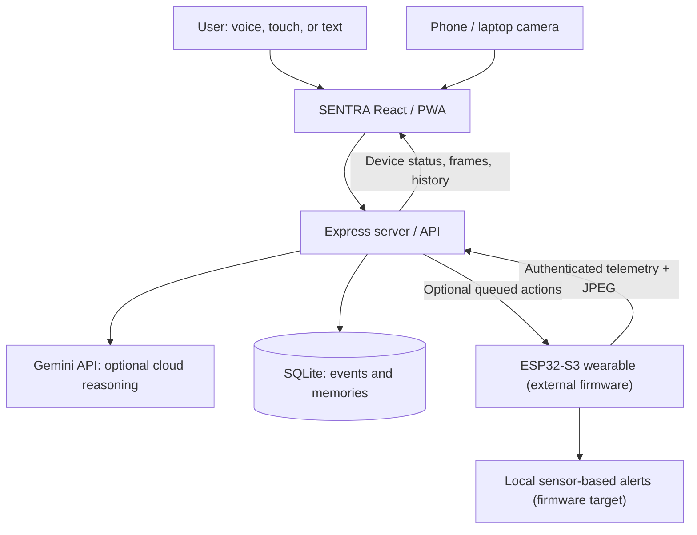

# SENTRA
### Spatially Intelligent Assistive System

**SENTRA** is an experiential-learning research prototype exploring how an **ESP32-S3-based wearable** and an **AI-assisted companion application** can help people who are blind or have low vision better understand their surroundings.

The project combines camera-based visual analysis, proximity-sensor telemetry, natural-language interaction, contextual memory, and event analytics. It follows an evidence-aware assistance cycle:

**UNDERSTAND → OBSERVE → REASON → ACT → VERIFY → UPDATE**

> **Prototype status:** This repository contains the React/TypeScript companion application and its Node/Express backend. Browser-camera, voice, Gemini, telemetry, wearable JPEG viewing, memory, and analytics code paths are present. Their behavior still requires browser, server, and end-to-end testing. **Physical ESP32-S3 firmware and validated independent navigation are not included in this repository.**

> **Safety:** SENTRA is an experimental aid, **not** a certified mobility or obstacle-avoidance device. It must not be used as the sole basis for walking, crossing roads, or avoiding hazards. An absence of detected obstacles is **not** confirmation of a safe path.

## What we are building

SENTRA has three cooperating parts:

| Part | Role |
| --- | --- |
| **ESP32-S3 wearable (hardware workstream)** | Intended to capture camera/sensor data, assess supported proximity measurements, and produce **immediate local alerts** without depending on a web page or cloud connection. Hardware firmware is a separate deliverable. |
| **SENTRA AI Assistant (web app experience)** | Browser camera preview, questions and voice interaction, on-demand Gemini AI Visual Analysis, object-search goals, active perception, and contextual memory. |
| **SENTRA Wearable Companion (web app experience)** | ESP32 device status, wearable JPEG preview, telemetry, event history, analytics, and diagnostics. |

**Current software packaging:** The AI Assistant and Wearable Companion are distinct *experiences within the same React application*, sharing one Express backend and database. They are not currently two separate native mobile apps. The web app has Progressive Web App (PWA) configuration for supported mobile browsers.

### System architecture



**Key distinction:** A live camera *preview* is not the same as continuous AI inference. Gemini is called for selected requests/frames; immediate sensor alerts must ultimately be handled locally by wearable firmware.

## Software features and implementation status

This table describes what is present **in source code**, not what has been independently verified on real hardware.

| Area | Implemented in this repository | Verification / limitations |
| --- | --- | --- |
| **Browser camera** | `getUserMedia` preview, start/stop, front/rear selection, frame capture, permission/error diagnostics | Requires a compatible browser and permission in a secure context; verify on each target device |
| **Voice interface** | Foreground “Hey SENTRA” phrase handling via Web Speech API; push-to-talk, tap-to-ask, speech output, typed fallback | Foreground availability varies by browser; not an always-on native wake-word engine |
| **AI Visual Analysis** | Server-side Gemini request and structured response handling for conversation and image-based queries | Requires valid API credentials, a model available to the account, and network access |
| **Object search and contextual memory** | Goal tracking, observed-object UI, saved memory records, evidence-aware responses | AI results can be inaccurate; historical memories must not be reported as live sightings |
| **Spatial awareness** | Relative object relationships, bearings and scene-based guidance UI | **Not** production-grade SLAM, localization, or verified navigation |
| **Wearable camera viewing** | ESP32 JPEG frame ingestion, latest-frame retrieval, polling, timestamps, stale-frame indicators | Requires compatible ESP32 camera firmware transmitting actual frames; not guaranteed high-FPS video |
| **Device integration** | Token-authenticated telemetry/frame upload, device registration, heartbeats, SSE status feed, action poll/ack routes | Device firmware is external; endpoints and compatibility require end-to-end testing |
| **Storage and analytics** | SQLite event/memory store, sensor/alert history, analytics endpoints and dashboard | Persistence depends on a durable server filesystem; simulated events are distinguishable |
| **Mobile installation** | Responsive interface and PWA manifest/service-worker configuration | PWA does not grant background microphone or native hardware permissions |

### Evidence and safety principles

- **Current observation ≠ saved memory.** A remembered location is historical until checked again.
- **No frame ≠ successful scene analysis.** The application should report unavailable visual evidence rather than invent an answer.
- **No detected obstacle ≠ safe route.** Camera and ToF measurements have limited coverage and can fail.
- **Simulation ≠ hardware.** Simulated readings are labeled separately and should not count as real-device evidence.
- **Critical local alerts are a firmware responsibility.** Server-generated alerts and queued messages in this repository are supplementary, not a substitute for on-device response.

## Technology

| Layer | Current stack |
| --- | --- |
| Frontend | React 19, TypeScript, Vite, Tailwind CSS 4, Lucide icons, D3 |
| Backend | Node.js, Express, TypeScript (`server.ts`) |
| AI | Google Gemini via `@google/genai`, called from the server |
| Validation | Zod and shared TypeScript protocol definitions |
| Data | SQLite through Node's `node:sqlite` API |
| Streaming / updates | Browser `MediaDevices` video, wearable JPEG snapshots, Server-Sent Events for telemetry |
| Mobile web | PWA manifest and service worker via `vite-plugin-pwa` |
| Tests | Vitest and TypeScript type checking |

## Getting started

### Prerequisites

- A recent **Node.js 22+** installation with `node:sqlite` support and npm.
- A modern browser. Camera and microphone access require a secure origin: **HTTPS** or **localhost**.
- A **Gemini API key** for cloud conversation and visual analysis.
- **Optional:** ESP32-S3 hardware and separate compatible firmware for device integration.

### Install and run

```bash
git clone https://github.com/makamsrujan/Sentra_EL.git
cd Sentra_EL
npm install
cp .env.example .env
npm run dev
```

Then open **http://localhost:3000**.

Edit `.env` before testing Gemini or hardware endpoints. In Google AI Studio, environment values may be supplied through its secrets/configuration instead of a local `.env`.

### Configuration

| Variable | Use |
| --- | --- |
| `GEMINI_API_KEY` | Server-side Gemini credential; required for AI requests |
| `SENTRA_GEMINI_MODEL` | Model name used by `server/geminiService.ts` |
| `SENTRA_DEVICE_TOKEN` | Optional shared device-write token; use a strong, private value |
| `SENTRA_OPERATOR_TOKEN` | **Important for secured deployments:** protects registration and simulator administration when configured; add to `.env` yourself |
| `SENTRA_SIMULATOR_ENABLED` | `true` or `false`; permits developer simulator endpoints when enabled |
| `SENTRA_HEARTBEAT_TIMEOUT_MS` | Telemetry inactivity timeout; default `15000` milliseconds |
| `SENTRA_DB_PATH` | SQLite file path; default `./data/sentra.db` |
| `PORT` | Server port; default `3000` |

**Model configuration note:** The checked-in `.env.example` uses `gemini-4-hydrogen`, and the server maintains a model allowlist/fallback. These are **code configuration values, not proof of model availability**. Confirm a configured model is actually accessible to your Gemini account. The current code may fall back to its default for names outside its allowlist.

**Security note:** Do not commit your `.env`, tokens, or API keys. Some read, memory, export, delete, and analysis endpoints are not protected by an end-user login layer in this codebase. **Do not publicly expose this development server or sensitive user data without adding appropriate user authentication, authorization, rate limits, and transport security.** Registration is only operator-protected when `SENTRA_OPERATOR_TOKEN` is configured.

### Typecheck, test and build

```bash
npm run lint    # TypeScript check: tsc --noEmit
npm test        # Vitest
npm run build   # Vite production build
```

For a production-style local start after building:

```bash
npm run start
```

These commands are provided by `package.json`. Their presence does **not** mean all tests have passed; run them in your own environment and review the output.

## Using SENTRA without wearable hardware

1. Open the **Assistant** or **Live Vision** experience.
2. Select **Live Camera**, then tap **Start Camera** and grant browser access.
3. Ask a general question by typing or using a supported voice input mode. General questions do not need a camera.
4. For a visual question, use a current camera frame and request **AI Visual Analysis**. A working Gemini connection is required for model-based scene interpretation.
5. Open **Device & Analytics** to inspect device information. With no real telemetry, the wearable should be reported as disconnected/unavailable rather than showing fabricated readings.
6. Optional developer simulator controls are for integration testing; their results are **not physical hardware measurements**.

**Camera/microphone troubleshooting:** If an embedded AI Studio preview denies access, open the actual app in a top-level HTTPS tab and try again. An iframe's permissions policy, browser permissions, OS permissions, device conflicts, and unsupported APIs can all prevent access. Permission granted to one origin or frame does not automatically grant it to another.

**Wake-word limitation:** The currently implemented “Hey SENTRA” behavior uses the browser's speech-recognition capabilities in an active foreground session. Browser support varies, especially on iOS. The app offers push-to-talk and typed input as alternatives. A genuine background/screen-off assistant requires a separately designed native or embedded solution.

## ESP32-S3 integration interface

The **ESP32-S3 remains the intended core controller of the wearable**. This repository provides the companion-side communication contract; actual sensor wiring, GPIO configuration, power system, and firmware must be developed and validated separately for the selected boards.

The proposed wearable arrangement places the camera/sensors on the head-mounted assembly and the controller/power electronics in a connected enclosure. The final pinout and module support depend on the confirmed physical hardware.

### Versioned telemetry packet

Send an authenticated JSON request to `POST /api/device/telemetry`. Example (illustrative, **not live sensor data**):

```json
{
  "schemaVersion": 1,
  "deviceId": "SENTRA-01",
  "sequence": 42,
  "uptimeMs": 184205,
  "batteryPercent": null,
  "sensors": {
    "forwardDistanceCm": 62,
    "downwardDistanceMm": null,
    "imu": null
  },
  "capabilities": {
    "camera": true,
    "forwardToF": true,
    "downwardToF": false,
    "imu": false,
    "audioOutput": false
  }
}
```

Use `null` for unavailable readings. The server validates telemetry and tracks freshness; do not turn absent, invalid, or zero readings into a claim of safe clearance.

### API reference

Hardware writes/polling use `Authorization: Bearer <token>` or `X-Device-Token: <token>`. Tokens can be provisioned via device registration or configured server-side.

| Method | Endpoint | Purpose |
| --- | --- | --- |
| `GET` | `/api/health` | Backend and configuration diagnostics |
| `POST` | `/api/device/register` | Register device and issue a one-time device token |
| `POST` | `/api/device/telemetry` | Upload validated device telemetry |
| `POST` | `/api/device/frame` | Upload JPEG image (binary `image/jpeg` preferred, maximum 5 MiB; JSON data URL compatibility exists) |
| `GET` | `/api/device/status` | Device connection and telemetry snapshot |
| `GET` | `/api/device/frame/status` | Frame sequence, timestamp, freshness, and connection information |
| `GET` | `/api/device/frame/latest` | Latest validated JPEG for the companion preview |
| `GET` | `/api/device/stream` | Live device/alert notifications via SSE |
| `GET` | `/api/device/poll?deviceId=...` | Authenticated retrieval of pending device actions |
| `POST` | `/api/device/ack` | Authenticated acknowledgment of action IDs |
| `GET` | `/api/analytics` | Event aggregates, sensor history, alert history |
| `GET` | `/api/events` | Paginated sensor events |
| `GET` | `/api/events/export` | Export stored events |
| `GET` / `POST` | `/api/memories` | Read/create contextual memories |
| `POST` | `/api/sentra/analyze` | Optional server-side Gemini analysis |

The developer simulator uses separate `/api/device/simulate` and `/api/device/simulate/frame` routes. It is not a substitute for real telemetry. See `server.ts`, `server/validation.ts`, and `src/types/deviceProtocol.ts` for exact request requirements.

### Wearable preview versus AI

- **Wearable camera preview:** Firmware uploads JPEG frames; the web application retrieves successive snapshots and marks stale frames. Actual refresh rate depends on camera, firmware, Wi-Fi, server, and browser behavior.
- **AI Visual Analysis:** A selected recent frame can be sent to Gemini for image understanding. This requires connectivity and a functional AI API configuration.
- **Immediate safety alerts:** Must operate *locally on the wearable*, independent of preview refresh, companion-app state, or network access. The present backend's alert/action queue does **not** establish local firmware safety performance.

## Repository guide

```text
src/
  App.tsx                  # Main SENTRA web experience
  components/              # Assistant, camera, memory, analytics, diagnostics UI
  hooks/                   # Camera, speech, wearable frames, telemetry, PWA hooks
  services/                # Browser camera and backend API clients
  types/                   # Shared app and ESP32 protocol types
  utils/                   # Parsing, audio, local visual heuristics
server/
  deviceGateway.ts         # Device state, authenticated communication, events
  eventStore.ts            # SQLite storage and analytics
  geminiService.ts         # Gemini reasoning and response handling
  validation.ts            # Input and response validation
server.ts                  # Express API and frontend serving
vite.config.ts             # Vite and PWA configuration
.env.example               # Example runtime configuration
```

## Evaluation and ongoing work

Suggested end-to-end demonstration (once the actual hardware and firmware are ready):

1. Show the ESP32 detecting a **stationary test object** using an actual sensor reading.
2. Verify its **local** alert behavior independently of the application.
3. Verify authenticated telemetry reaches the Express backend.
4. Confirm a real event appears in the device dashboard and persistent history.
5. If camera firmware is ready, demonstrate incoming JPEG frames in **Wearable Camera**.
6. Run an optional on-demand visual question with a fresh camera frame and Gemini.
7. Test reconnecting the wearable and confirm stale/disconnected states are displayed accurately.

**Future research directions:** more robust embedded perception, calibrated sensing, supported on-device wake-word/audio, improved low-light performance, reliable spatial localization and mapping, accessible user testing, power optimization, and appropriate safety validation. **Full Visual-Inertial SLAM is a research goal, not a completed feature.**

## License

Distributed under the [MIT License](LICENSE). Copyright © 2026 Srujan Makam.
