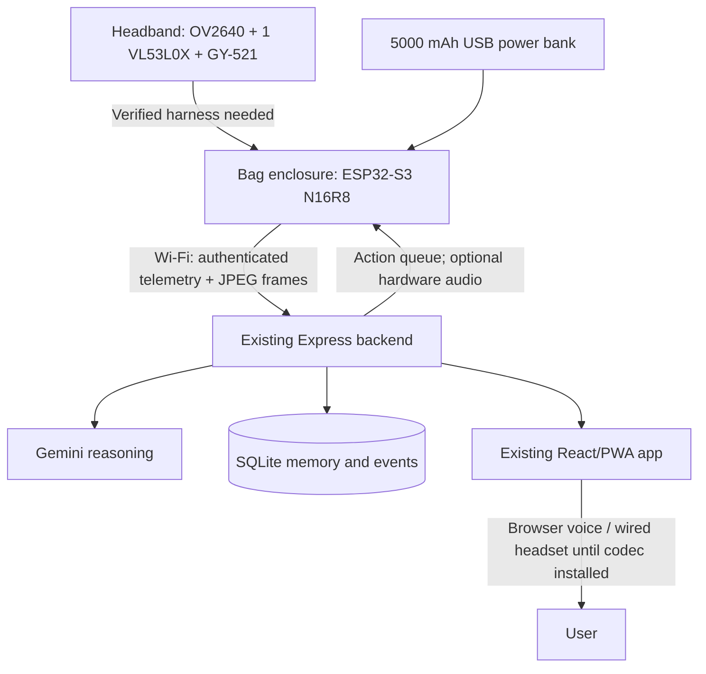

# SENTRA hardware-to-app integration contract

## Fixed physical layout

- **Headband:** one standalone OV2640 camera (interface/pinout still to be verified), one VL53L0X forward ToF sensor, and one GY-521 module containing the MPU6050 IMU.
- **Bag-mounted enclosure:** ESP32-S3 N16R8, 5000 mAh USB power bank, perfboard and wiring.
- **Optional later:** VL53L5CX multi-zone depth sensor and WM8960 audio codec.
- **Voice during codec-unavailable phase:** browser/phone microphone and wired headset. Hardware audio is not claimed ready.
- **Wired harness:** connects the headband to the enclosure; camera signal integrity at the required cable length is unverified.

## Existing API boundary

The application already defines `TelemetryPayloadV1` and `DeviceCapabilities` in `src/types/deviceProtocol.ts`. Keep `schemaVersion: 1` and the existing endpoint contracts stable during hardware integration.

1. Register/provision the ESP32 using `POST /api/device/register` with operator authorization; protect the issued device token.
2. Send authenticated readings to `POST /api/device/telemetry`. Use `forwardDistanceCm` for the **one** forward VL53L0X. Set `downwardDistanceMm: null` and `downwardToF: false` unless a physically installed and verified downward sensor exists.
3. Send camera JPEGs using the existing authenticated frame-upload endpoint; consume them through the app's wearable frame APIs. A JPEG frame is not proof of safe navigation.
4. Report IMU readings only when the GY-521 has initialized and provided valid measurements; otherwise send `imu: null` and reflect capability accurately.
5. Report `batteryPercent: null` unless there is a validated measurement source. A USB power bank's rated capacity alone cannot yield real battery percentage.
6. Keep unavailable audio hardware capabilities false and use the browser/phone voice path until codec and headset routing are verified.
7. Do not substitute simulated sensor data for live readings without clearly marking the simulator source.

## Arrival acceptance sequence

1. Confirm exact board revision, camera connector/pinout, power and GPIO constraints before wiring.
2. Flash a minimal ESP32 Wi-Fi build; confirm authenticated device registration and heartbeat/telemetry.
3. Test GY-521 and the single VL53L0X separately, then together.
4. Verify camera JPEG capture with a short connection, then at the actual headband cable length.
5. Verify live app frame freshness and selected-device isolation; disconnect the wearable and ensure stale data is not displayed as current.
6. Only after codec purchase, test optional WM8960 capture/playback at safe earphone volume.
7. Run supervised stationary demonstrations of object description, sensor alerts and voice responses. Do not represent this prototype as independently safe for mobility.

**Status:** Source-level integration preparation; no claim of completed firmware compilation, hardware verification, autonomous SLAM, or physical plug-and-play.
