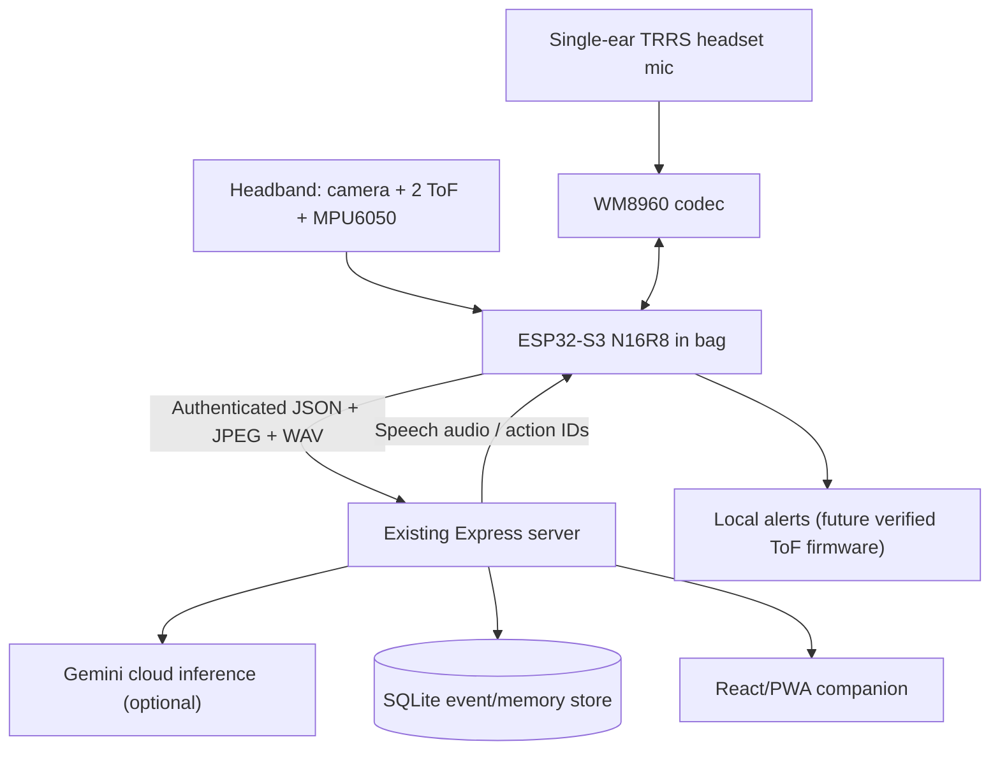

# SENTRA intended architecture

**Current source status:** Wi-Fi, camera, backend, and audio source exist, but
some hardware acquisition paths remain incomplete. Browser speech is foreground
only. The system is not validated for independent walking.
