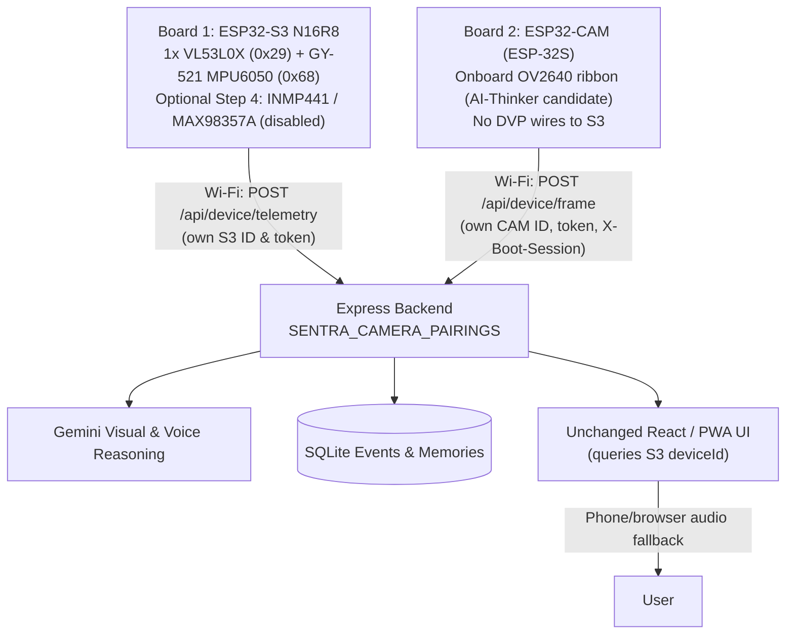

# SENTRA Two-Board Hardware-to-App Integration Architecture

## Physical Two-Board Layout

- **Board 1 — ESP32-S3 N16R8 (`firmware/esp32s3/`):**
  - Connected over I²C (`SDA = GPIO4`, `SCL = GPIO40`, `100 kHz`) to **1 × GY-521 MPU6050 (`0x68`)** and **1 × forward VL53L0X (`0x29`)**.
  - Publishes authenticated telemetry to `POST /api/device/telemetry` under its own device ID (e.g., `ESP32-S3-SENTRA-001`).
  - Optional Step 4 discrete audio (`INMP441` RX + `MAX98357A` TX) is **disabled by default**; phone/browser audio remains the fallback.
- **Board 2 — Separate ESP32-CAM (`firmware/esp32cam/`):**
  - Runs on the original ESP32 (ESP-32S module, AI-Thinker first-candidate pinout).
  - The OV2640 ribbon stays directly on the ESP32-CAM — **zero DVP wires** run between the ESP32-CAM and ESP32-S3.
  - Uploads authenticated JPEG frames to `POST /api/device/frame?deviceId=ESP32-CAM-SENTRA-001` with its **own** `X-Device-Token`, `X-Boot-Session`, and `X-Frame-Sequence`.
- **Backend Pairing (`server/deviceGateway.ts`, zero frontend changes):**
  - Operator configures `SENTRA_CAMERA_PAIRINGS="ESP32-S3-SENTRA-001=ESP32-CAM-SENTRA-001"` in `.env`.
  - The unchanged React UI keeps polling/viewing `ESP32-S3-SENTRA-001`.
  - The backend resolves `GET /api/device/frame/status`, `GET /api/device/frame/latest`, `POST /api/sentra/analyze`, `VoiceTurnService`, and Live Voice frames from `ESP32-CAM-SENTRA-001` while preserving `deviceId: "ESP32-S3-SENTRA-001"` and `X-Device-Id: ESP32-S3-SENTRA-001` (and exposing `X-Camera-Device-Id: ESP32-CAM-SENTRA-001` for operator inspection).



## Independence, Reboot Safety, and Fail-Closed Rules

1. **Independent auth:** S3 token cannot post frames as CAM; CAM token cannot post telemetry as S3.
2. **Independent health:** If ESP32-CAM goes offline, S3 telemetry stays connected with live ToF/IMU while camera status reports `unavailable` / `disconnected` and `GET /api/device/frame/latest` returns HTTP `404`. If S3 goes offline, ESP32-CAM remains independently connected.
3. **Camera-only reboot safety:** ESP32-CAM generates a fresh `X-Boot-Session` on each boot; the backend assigns strictly monotonic server frame sequences so resetting client `X-Frame-Sequence` back to `1` never stalls frame updates.
4. **No silent fallback:** Offline or stale paired cameras never fall back to another camera ID or simulator frames.
5. **Backward compatibility:** When `SENTRA_CAMERA_PAIRINGS` is empty or unset for a device, single-device telemetry + frame ingestion works identically to before.

## Documented Limitation: Inspecting Separate Board Health Without UI Changes

Because the frontend is strictly unchanged, the UI displays one combined status view under the selected S3 device ID. Operators can inspect each board independently via the existing HTTP API:

```bash
# 1. Confirm active backend pairing map
curl -s http://localhost:3000/api/health | jq .cameraPairings

# 2. Inspect ESP32-S3 sensor board health (ToF, IMU, paired frame summary)
curl -s "http://localhost:3000/api/device/status?deviceId=ESP32-S3-SENTRA-001" | jq

# 3. Inspect ESP32-CAM board health independently
curl -s "http://localhost:3000/api/device/status?deviceId=ESP32-CAM-SENTRA-001" | jq

# 4. Inspect paired frame status and headers (X-Device-Id = S3, X-Camera-Device-Id = CAM)
curl -s "http://localhost:3000/api/device/frame/status?deviceId=ESP32-S3-SENTRA-001" | jq
curl -sI "http://localhost:3000/api/device/frame/latest?deviceId=ESP32-S3-SENTRA-001" | grep -iE "HTTP/|x-device-id|x-camera-device-id|x-frame-"
```
